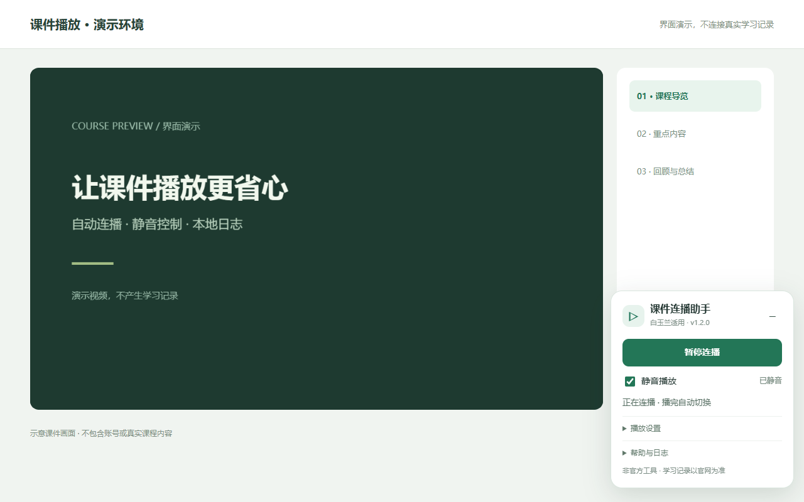
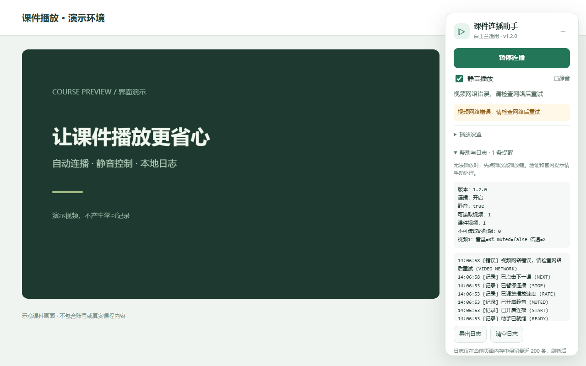

# 白玉兰远程医学网学习助手 · 课件连播助手

**白玉兰课件自动连播、静音播放、倍速与本地错误日志。Chrome / Edge 浏览器扩展和油猴脚本共用同一份源码、同一套界面。**

[项目主页](https://jiamuho.github.io/byljx-helper/) · [下载最新版本](https://github.com/jiamuho/byljx-helper/releases/latest) · [安装脚本](https://raw.githubusercontent.com/jiamuho/byljx-helper/main/byljx-helper.user.js) · [反馈问题](https://github.com/jiamuho/byljx-helper/issues) · [MIT 许可证](LICENSE)

适用网站：[白玉兰远程医学网](https://byljxjy.com/)（`byljxjy.com`、`www.byljxjy.com`）。这是独立开发的**非官方工具**，与白玉兰平台没有隶属或授权关系。

## 下载与选择

| 版本 | 下载 | 安装方式 |
| --- | --- | --- |
| Chrome / Edge 扩展 v1.2.0 | [扩展 ZIP](https://github.com/jiamuho/byljx-helper/releases/download/v1.2.0/byljx-helper-1.2.0-chrome-edge.zip) | 当前为 GitHub 发布版：解压后在扩展管理页加载文件夹 |
| 脚本 v1.2.0 | [安装 / 更新 .user.js](https://raw.githubusercontent.com/jiamuho/byljx-helper/main/byljx-helper.user.js) · [固定版本下载](https://github.com/jiamuho/byljx-helper/releases/download/v1.2.0/byljx-helper-1.2.0.user.js) | 需已安装 Tampermonkey 或 ScriptCat |
| 校验文件 | [SHA256SUMS.txt](https://github.com/jiamuho/byljx-helper/releases/download/v1.2.0/SHA256SUMS.txt) | 可选：核对下载文件完整性 |

**Chrome 和 Edge 商店目前均未上架**，没有商店一键安装链接。GitHub ZIP 是公开下载包，不能双击直接安装。扩展和脚本二选一，请停用旧版本及重复安装，避免同时控制播放器。

## 界面预览



截图为本地演示环境，不包含真实账号或课程数据。主要操作是“开始/暂停”和“静音播放”；倍速与错误日志默认收起。

## 功能

- **课件自动连播**：当前视频自然播完后等待 5 秒，再点击当前项目列表的下一课；最后一课结束后停止。
- **静音兼容**：静音时将音量降为零，兼容播放器自行取消 `muted` 的情况；取消静音恢复原音量。
- **可选倍速**：支持 0.5、1、1.25、1.5、2、3、4 倍，显示播放器实际倍速。
- **开始与暂停**：暂停会停止视频并取消待切课任务；收起面板则继续运行。
- **本地错误日志**：播放、网络、切课或设置保存失败会显示提醒，可导出和清空最近 200 条日志。
- **统一界面**：扩展与脚本来自 `src/helper.js`，功能和界面一致，仅设置的存储方式不同。

学习进度、课时、倍速是否被认可均以官网记录和规则为准。工具不直接提交学习记录，不自动考试、不处理验证、不承诺“一分钟完成课程”。

## 安装扩展（Chrome / Edge）

1. 下载扩展 ZIP，解压到保留使用的文件夹，确认里面直接有 `manifest.json`。
2. Chrome 打开 `chrome://extensions`；Edge 打开 `edge://extensions`。
3. 开启“开发者模式”，选择“加载已解压的扩展程序”或“加载解压缩的扩展”，选择该文件夹。
4. 停用旧油猴脚本和重复扩展，刷新已经打开的白玉兰课件页面。
5. 登录自己的账号，进入课件播放页，点击右下角“开始连播”。

更新 GitHub 扩展版时，解压新版后重新加载扩展并刷新课件页；不要删除扩展正在引用的文件夹。

## 安装脚本（Tampermonkey / ScriptCat）

1. 安装并启用 Tampermonkey（油猴）或 ScriptCat（脚本猫）。
2. 点击 [安装脚本](https://raw.githubusercontent.com/jiamuho/byljx-helper/main/byljx-helper.user.js)，在脚本管理器打开的页面中确认安装。
3. 如果浏览器只显示源代码，可在脚本管理器中新建脚本，粘贴完整内容并保存。
4. 停用旧版脚本、重复脚本和本扩展版，刷新白玉兰课件页，再点击“开始连播”。

新版脚本使用脚本管理器的本地存储，不读取旧版网页 localStorage 设置。升级后首次需重新选择偏好，后续由脚本管理器根据脚本更新地址检查更新。

## 使用与排错

- **无法自动播放**：浏览器可能要求一次手动交互，点击视频自己的播放键后再试。
- **静音与恢复声音**：取消静音后再检查官网播放器和系统音量。诊断中 `muted=false`、`音量=0%` 仍表示无声。
- **助手不出现**：确认已经进入课件播放页、刷新过页面，并且只启用一个版本。面板只在识别到课件区域时出现。
- **没有自动切课**：确认自动切课开启，官网没有提示或验证；跨域播放器或网站结构变化可能需要适配。不要只根据面板判断课时已入账。
- **反馈问题**：展开“帮助与日志”，导出后到 [GitHub Issues](https://github.com/jiamuho/byljx-helper/issues) 提交，附浏览器版本、助手版本和操作步骤。



## 隐私与权限

扩展仅请求 `storage` API 权限，仅在官网两个 HTTPS 域名运行；脚本仅使用 `GM_getValue`、`GM_setValue` 保存自己的偏好。两者均不读取密码、Cookie、登录凭证、姓名、手机号或考试内容，不向开发者服务器发送数据，不加载远程代码。

日志只记录助手自己的预定义事件和时间，不记录页面地址、课件名称、视频地址或账号信息。日志保存在当前页面内存，刷新或关闭页面会清除；主动导出后的文本文件由用户保管。视频源标识只在内存中用于结束事件去重，不保存或导出。

详见 [隐私说明](https://jiamuho.github.io/byljx-helper/privacy.html)。GitHub 托管的网页、下载和脚本更新由 GitHub 提供，适用 GitHub 自身的服务规则。

## 开发与构建

需要 Node.js 22 或更新版本：

```sh
npm ci
npm run build
npm run check
npm test
npm run package
```

打包结果位于 `dist/`，包含扩展 ZIP、脚本和 SHA-256 校验文件。版本维护在 `package.json`，不要分别手动修改两个版本。

```text
src/helper.js              # 界面、播放器、切课、日志的唯一共享源码
extension/                 # 扩展运行文件、弹窗、图标和隐私页
byljx-helper.user.js        # 生成的脚本安装文件
tools/                     # 构建、图标、跨平台 ZIP 打包
tests/                     # 双版本检查和浏览器演示验证
docs/                      # GitHub Pages 项目介绍与下载页
```

自动检查包含双版本模拟行为测试和共享源码一致性检查。浏览器演示测试模拟扩展 API，不等同于真实安装、脚本管理器运行或登录后的官网端到端验收。可设置 `BYL_TEST_BROWSER` 指向本机 Chromium 浏览器，再运行 `npm run test:browser`。

贡献方法见 [CONTRIBUTING.md](CONTRIBUTING.md)，版本记录见 [CHANGELOG.md](CHANGELOG.md)。

## 项目关键词

白玉兰远程医学网、白玉兰学习助手、白玉兰课件连播、白玉兰自动播放脚本、白玉兰静音播放、白玉兰倍速、白玉兰浏览器扩展、byljxjy、Tampermonkey、ScriptCat、Chrome、Edge。

## 开源许可

本项目独立实现的代码和原创演示素材采用 [MIT License](LICENSE)。网站课程、官网代码、名称商标及其他第三方内容的权利归各自权利人所有，不属于本仓库授权范围。
